<!--
  README in the Okami 2026 look with a Mirrored skin. The pictures in docs/readme/parts/ are rendered
  from the stream kit: branding/github/mirrorgate.html → node tools/export/github-mirrorgate.mjs
-->
<div align="center">

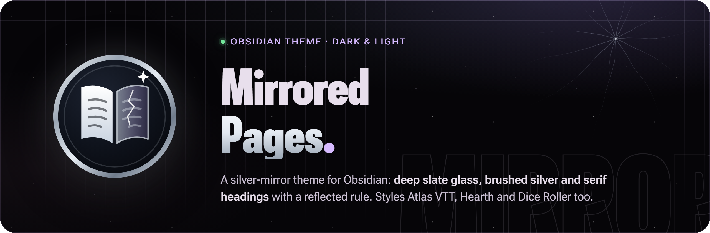

<br>

<a href="#installing">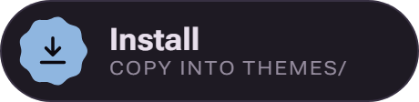</a>
<a href="https://github.com/ShadowOkami4/Mirrorgate">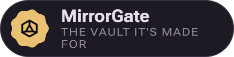</a>
<a href="https://shadowokami.com">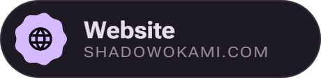</a>
<a href="https://ko-fi.com/W7W31TOGEY">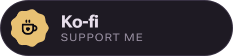</a>

</div>

<br>

Made for [The Mirrored Realms](https://github.com/ShadowOkami4/Mirrorgate), a tabletop RPG setting written as an Obsidian vault, but it works in any vault.

<a id="a-look-inside"></a>
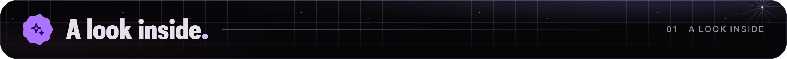

<p align="center">
  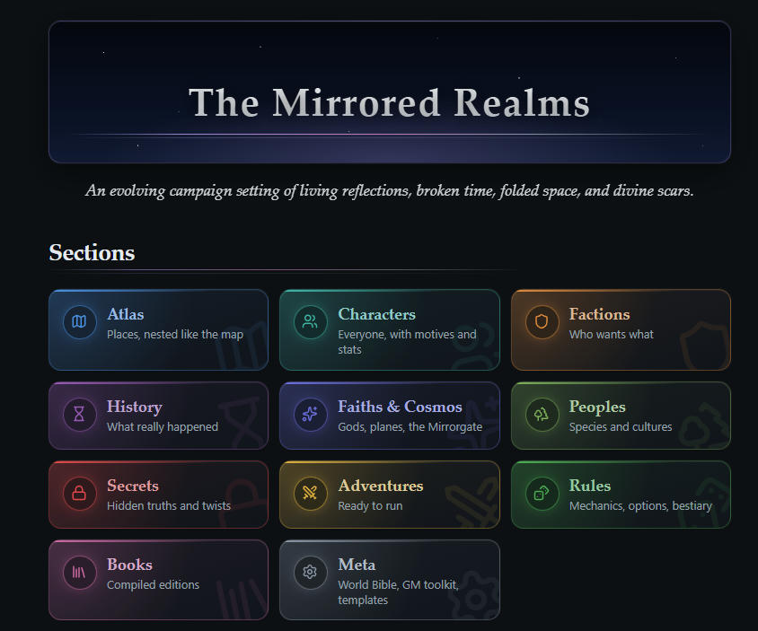
  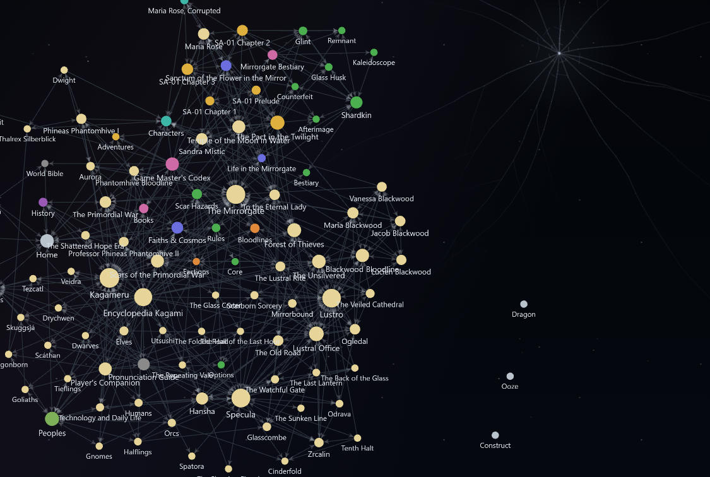
</p>
<p align="center"><em>Section cards on a hub page, and the night-sky graph view.</em></p>

<p align="center">
  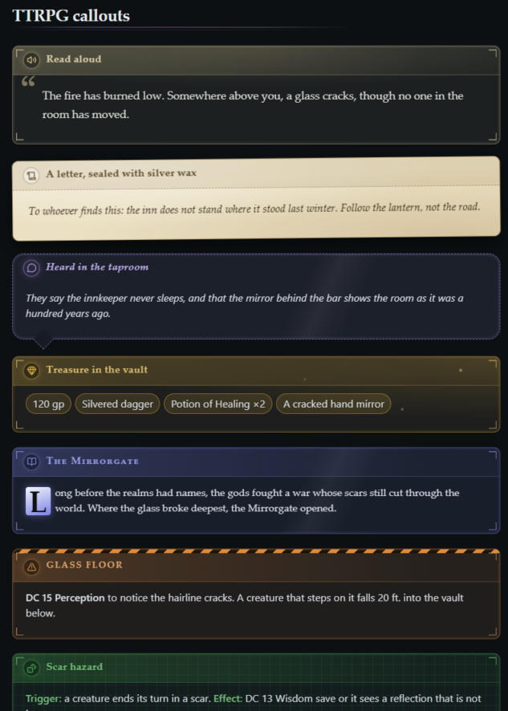
  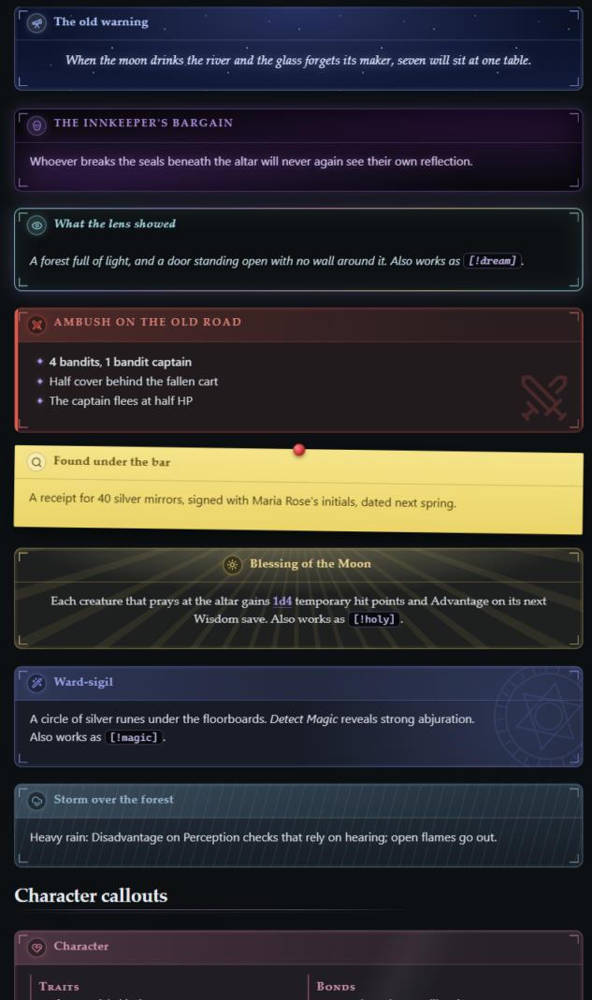
  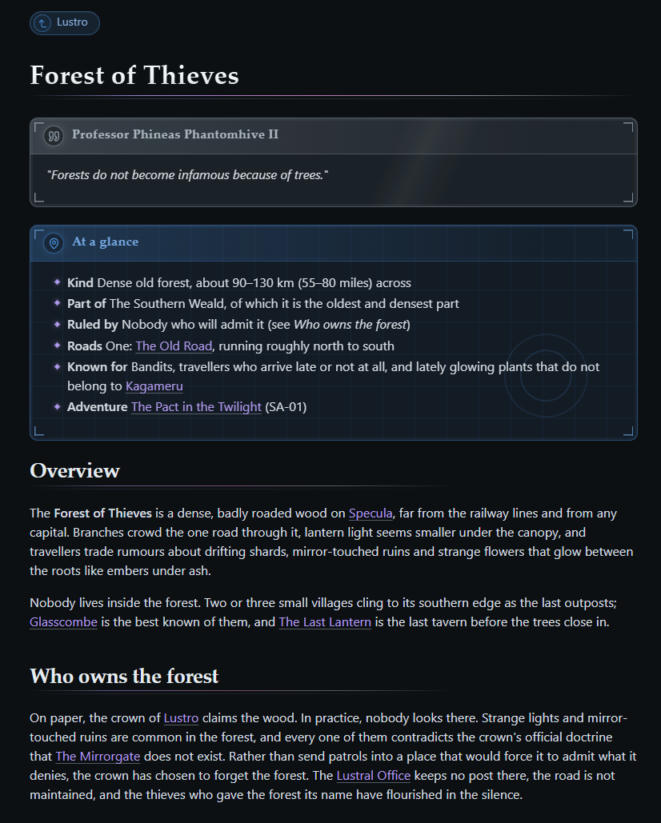
</p>
<p align="center"><em>Every TTRPG callout has its own design, and pages get quote and at-a-glance boxes.</em></p>

<details>
<summary><strong>Atlas VTT statblocks</strong></summary>
<p align="center">
  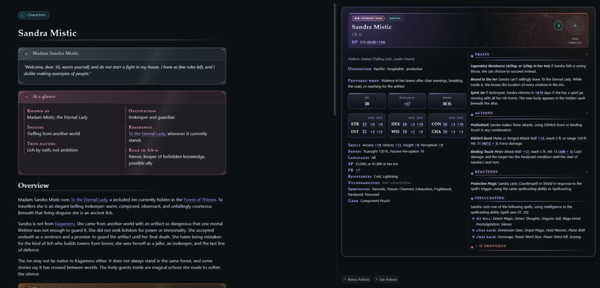
</p>
<p align="center">
  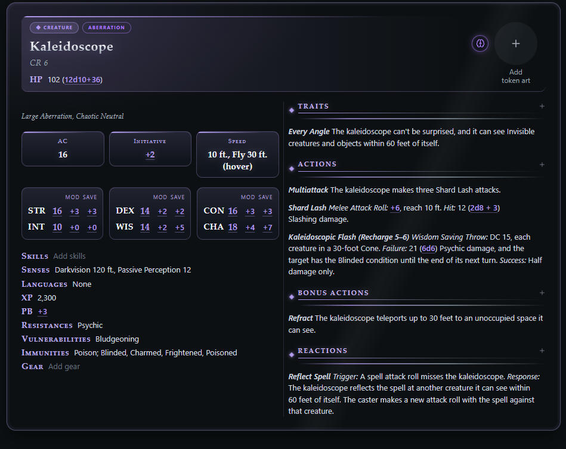
  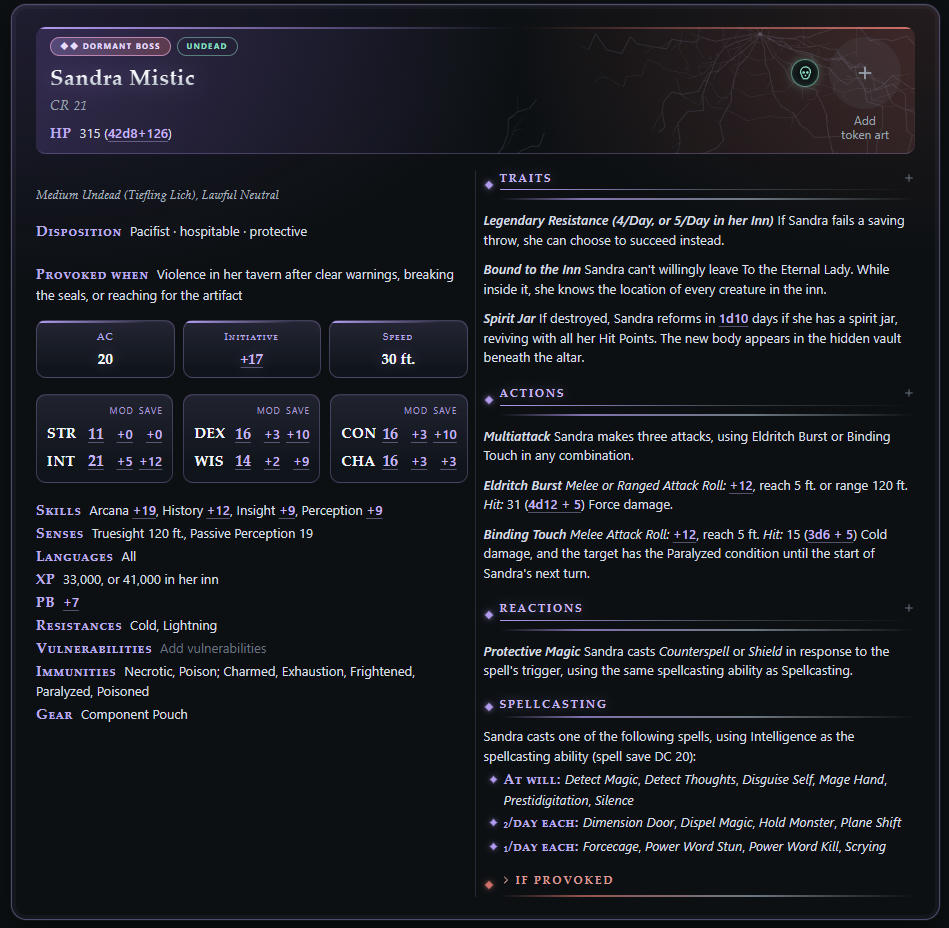
  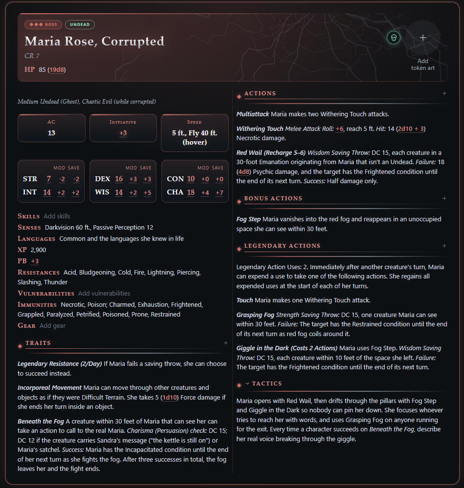
</p>
<p align="center"><em>Creature, Dormant Boss and Boss: each rank has its own colours, and every statblock shows its creature type.</em></p>
</details>

<a id="features"></a>


### Look

- **Dark and light modes.** Slate, obsidian or pewter surfaces in the dark; brushed silver in the light.
- **Silver headings.** A soft sheen on titles and a mirrored double rule under the first two heading levels.
- **Mirror-pane blockquotes** with a large quotation mark and a double accent bar.
- **Mirror-shard separators:** `---` becomes a silver line with a glowing diamond.
- **Glass keyboard keys** for `<kbd>`, a diamond before level-3 headings and small caps for level 4, and an optional drop cap.
- **Text details:** links that glow on hover, diamond list bullets, glowing checkboxes, tag pills, soft highlight glow, code chips and accent footnote numbers.
- **Tables and Bases:** small-caps headers with an accent rule, striped rows, hover highlight, a tinted Bases toolbar.
- **Frames for properties, embedded notes, images and code blocks.**
- **A small cracked mirror-shard emblem** in the bottom-right corner of every note.
- **No external requests.** No web fonts or images are loaded; headings use serif fonts already on your system.

### Callouts

- **Callouts framed like small mirrors:** a tinted title band, a round icon badge, silver corner brackets and a diagonal glint. Every callout type has its own colour.
- **A `[!gm]` callout** for Game Master notes, with a *GM only* corner ribbon.
- **A `[!player]` callout** for text players may read, drawn as a card with a *Player info* corner ribbon.

### Workspace

- **Frosted-glass menus and pop-ups**, with framed hover previews.
- **A livelier workspace:** glowing active file and accent-lined active tab, tinted folder icons, ribbon icons that glow on hover, a glass status bar.
- **Custom task states:** `[/]` in progress, `[-]` cancelled, `[!]` important, `[?]` question, `[>]` moved, `[*]` starred, each with its own icon and colour.
- **Section pages.** A note with `cssclasses: hub` gets a header panel in its section colour, with the section icon and a large faded copy of it; the first paragraph after the back link reads as a lead.
- **Back links.** `> [!up] [[Parent]]` becomes a slim pill with an up-arrow badge.
- **Section cards.** Add `cssclasses: hub` to a note, and each list under a heading becomes a grid of cards in reading view: icon badge, coloured top edge, subtitle and a large faded icon. Text after the link, such as `<small>Places and maps</small>`, becomes the subtitle.
- **Night-sky graph view behind cracked mirror glass** in dark mode, and a pale dawn sky in light mode.

### Plugins

- **Ranked statblocks for Atlas VTT.** Layout names decide the look: *character* (gold), *creature* (mirror accent), *npc* (silver), *important* (violet), *boss* (crimson, cracked glass), *dormant* (violet turning crimson) and *companion* (green with a paw badge, for familiars, mounts and pets). A rank tag and a creature-type tag sit above the name.
- **Atlas VTT support.** The [Atlas VTT](https://github.com/ByteMirror/atlas-vtt) plugin picks up the theme's colours, accents and dice font.
- **Dice Roller support.** The [Dice Roller](https://github.com/javalent/dice-roller) sidebar gets glass dice tiles, a rounded advantage / disadvantage switch, a gradient roll button and mirror cards for results.
- **Hearth support.** The [Hearth](https://github.com/ondreu/Hearth) start screen gets the night sky and mirror cracks, a silver serif title and framed mirror cards.

<a id="settings"></a>
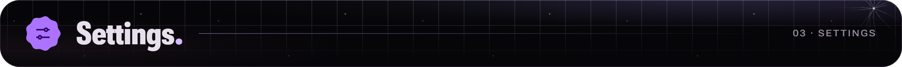

<p align="center">
  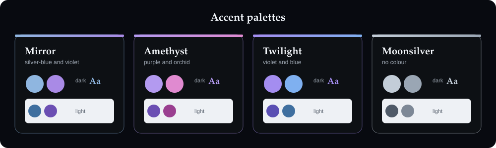
</p>

Install [Style Settings](https://github.com/mgmeyers/obsidian-style-settings) to change:

| Setting | Options |
| --- | --- |
| Accent palette | Mirror (silver-blue and violet), Amethyst (purple), Twilight (violet and blue), Moonsilver (no colour) |
| Mirror accent | any colour, separately for dark and light; overrides the palette |
| GM callout colour | any colour, separately for dark and light |
| Player info colour | any colour, separately for dark and light |
| Surface | slate, obsidian, pewter |
| Framed panes | on / off (off: sidebars, ribbon and tabs share one seamless surface) |
| Heading style | serif or sans-serif |
| Serif body text | on / off |
| Page width | 560–1100 px |
| Heading sheen, reflected rule, page emblem, night sky, mirror cracks | on / off |
| Callout style | High, Medium, Minimal |
| Blockquote style | High, Medium, Minimal |
| Drop cap, heading ornaments | on / off |
| Glass blur | 0–24 px |

<a id="installing"></a>
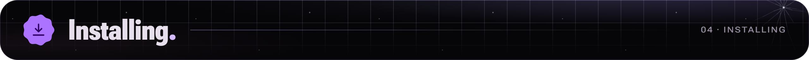

### Requirements

Obsidian 1.15 or newer.

### Installing

**From Obsidian:** Settings → Appearance → Themes → Manage → search for *Mirrored Pages*. *(Pending review for the community theme list.)*

**By hand:** copy `theme.css` and `manifest.json` into `<your vault>/.obsidian/themes/Mirrored Pages/`, then choose *Mirrored Pages* under Settings → Appearance → Themes.

<a id="ttrpg-callouts"></a>
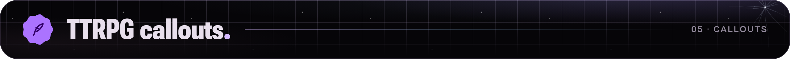

### Link buttons

```html
<a class="button" href="https://example.com">Open the map</a>
```

A glowing pill button for important links. Add `dndbeyond` to the class for a red D&D Beyond button.

### Coins

```html
<span class="coin pp">2</span> <span class="coin gp">34</span> <span class="coin ep">1</span> <span class="coin sp">33</span> <span class="coin cp">107</span>
```

Each coin gets its own metal: platinum, gold, electrum, silver, copper.

### Keyword callouts

Each keyword has its own design, not just its own colour:

| Callout | Design |
| --- | --- |
| `[!read-aloud]` / `[!boxed]` | boxed text to read to players: large serif with a quotation mark |
| `[!handout]` | a sheet of parchment, slightly tilted, dark ink |
| `[!rumor]` | a dashed speech bubble with a tail |
| `[!loot]` | gold glints; list items become chips |
| `[!lore]` | an illuminated first letter |
| `[!trap]` / `[!hazard]` | warning stripes along the top |
| `[!rule]` / `[!mechanic]` | graph paper |
| `[!music]` / `[!ambience]` | equaliser bars along the bottom |
| `[!timeline]` | a vertical line with a ring per list entry |
| `[!location]` | a faint map grid with contour rings |
| `[!quest]` | a banner title |
| `[!secret]` | a wax seal |
| `[!shattered]` / `[!mirror]` | a pane of glass struck near the top-right corner |
| `[!prophecy]` | a night sky with glowing, centred text |
| `[!curse]` | dark smoke closing in |
| `[!vision]` / `[!dream]` | soft, iridescent edges |
| `[!combat]` | crossed swords and a red edge |
| `[!clue]` | a pinned sticky note |
| `[!divine]` / `[!holy]` | golden rays from above |
| `[!arcane]` / `[!magic]` | a rune circle |
| `[!weather]` | slanted rain |
| `[!professor]` / `[!phineas]` | **the Professor's annotation**: ink-blue ruled vellum with a red margin line, a Phantomhive wax seal (a hive-cell hexagon around a P), a folded corner, a satin bookmark ribbon, and the title signed beneath the quote with a pen flourish |

With *Callout style: Minimal* they all fall back to a plain tinted box. `docs/design-test.md` shows every design in the theme on one page.

### Character callouts

`[!personality]`, `[!appearance]`, `[!backstory]`, `[!companions]`, `[!purse]`, `[!inventory]` and `[!notes]` have their own colours and icons. Lists inside personality and appearance become two-column fact grids; tables inside callouts fill the callout.

### GM and player callouts

```markdown
> [!gm]- GM only
> The innkeeper is the thief.

> [!player] What players know
> The inn is warm, cheap and never empty.
```

<a id="statblocks"></a>
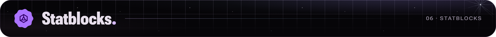

### Creature types

Atlas VTT statblocks show the creature's type as a tag next to the rank tag above the name, and as a small round seal beside the token. The statblock itself keeps its rank colours (NPC silver, Important violet, Boss red, Dormant violet to red).

| Type | Seal |
| --- | --- |
| Undead | green skull |
| Fiend | ember flame |
| Celestial | golden sun |
| Fey | pink sparkles |
| Dragon | bronze slit-pupil eye |
| Construct | steel cog |
| Aberration | violet brain |
| Elemental | blue tornado |
| Giant | stone mountain |
| Monstrosity | orange DNA |
| Ooze | green droplets |
| Plant | green leaf |
| Beast | brown paw |

How it works: Atlas can't hand a field's value to CSS, so the Mirrored Realms Creature, NPC, Important NPC, Boss and Dormant Threat templates start with thirteen hidden marker blocks. Atlas shows only the one whose condition matches the `creature_type` field, and the theme reads that marker. The match is exact but ignores case: write the plain type (`Undead`) and put anything extra in `subtype` (`Tiefling Lich`). To use it in your own Atlas template, copy the first thirteen blocks from one of those templates.

<a id="make-it-yours"></a>


### Bestiary titles

Add `bestiary` to a creature note's `cssclasses`. Its title becomes centred, letter-spaced silver capitals with a *Mirrorgate Bestiary* label above, a diamond below, and a diagonal slice of the name knocked out of place like a broken pane (in reading view).

### Custom card colours and icons

Each card reads two variables, so a CSS snippet in your vault can give a card its own look by matching the link name:

```css
body .hub .el-ul > ul > li:has(> a.internal-link[data-href="Atlas"]) {
  --mp-card-color: #4a90e2;
  --mp-card-icon: url("data:image/svg+xml;utf8,…");  /* any SVG; used as a mask */
}
```

### Section colours

Set two variables on a page class, and every note with that class in `cssclasses` uses them for its header, back link and accents:

```css
.mr-atlas {
  --mp-section-color: #4a90e2;
  --mp-section-icon: url("data:image/svg+xml;utf8,…");
  --mp-section-name: "Atlas";   /* shown in hover previews */
}
```

Hover previews of hub pages show a small header band with the section icon and name, followed by the lead text.

<a id="license"></a>
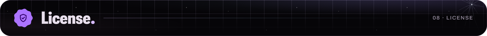

[MIT](LICENSE) © Okami. The default card icon and the creature-type seals are from [Lucide](https://lucide.dev) (ISC License).

The theme and the README pictures were made with the help of Claude, an AI assistant by Anthropic: the header, section bars, pills and footer are rendered from Okami's stream kit branding page (Roboto Flex, SIL Open Font License), and the palette graphic is drawn as code. The screenshots show [The Mirrored Realms](https://github.com/ShadowOkami4/Mirrorgate) vault with this theme.

<br>

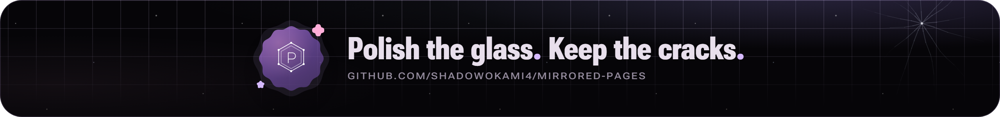

<p align="center"><em>A mirror does not lie. It only forgets which side of the glass you were standing on.</em></p>
