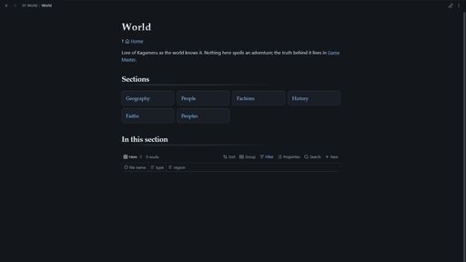

# Mirrored Pages



A silver-mirror theme for [Obsidian](https://obsidian.md): deep, dark slate glass in dark mode, brushed silver in light mode, and serif headings with a reflected rule beneath them.

Made for [The Mirrored Realms](https://github.com/ShadowOkami4/Mirrorgate), a tabletop RPG setting written as an Obsidian vault, but it works in any vault.

## Features

- **Dark and light modes.** Slate, obsidian or pewter surfaces in the dark; brushed silver in the light.
- **Silver headings.** A soft sheen on titles and a mirrored double rule under the first two heading levels.
- **Callouts framed like small mirrors:** a tinted title band, a round icon badge, silver corner brackets and a diagonal glint. Every callout type has its own colour.
- **Mirror-pane blockquotes** with a large quotation mark and a double accent bar.
- **Mirror-shard separators:** `---` becomes a silver line with a glowing diamond.
- **Frosted-glass menus and pop-ups**, with framed hover previews.
- **A livelier workspace:** glowing active file and accent-lined active tab, tinted folder icons, ribbon icons that glow on hover, a glass status bar.
- **Custom task states:** `[/]` in progress, `[-]` cancelled, `[!]` important, `[?]` question, `[>]` moved, `[*]` starred, each with its own icon and colour.
- **Glass keyboard keys** for `<kbd>`, a diamond before level-3 headings and small caps for level 4, and an optional drop cap.
- **Text details:** links that glow on hover, diamond list bullets, glowing checkboxes, tag pills, soft highlight glow, code chips and accent footnote numbers.
- **Tables and Bases:** small-caps headers with an accent rule, striped rows, hover highlight, a tinted Bases toolbar.
- **Frames for properties, embedded notes, images and code blocks.**
- **A `[!gm]` callout** for Game Master notes, with a *GM only* corner ribbon.
- **A `[!player]` callout** for text players may read, drawn as a card with a *Player info* corner ribbon.
- **Section pages.** A note with `cssclasses: hub` gets a header panel in its section colour, with the section icon and a large faded copy of it; the first paragraph after the back link reads as a lead.
- **Back links.** `> [!up] [[Parent]]` becomes a slim pill with an up-arrow badge.
- **Section cards.** Add `cssclasses: hub` to a note, and each list under a heading becomes a grid of cards in reading view: icon badge, coloured top edge, subtitle and a large faded icon. Text after the link, such as `<small>Places and maps</small>`, becomes the subtitle.
- **A small cracked mirror-shard emblem** in the bottom-right corner of every note.
- **Night-sky graph view behind cracked mirror glass** in dark mode, and a pale dawn sky in light mode.
- **Hearth support.** The [Hearth](https://github.com/ondreu/Hearth) start screen gets the night sky and mirror cracks, a silver serif title and framed mirror cards.
- **Ranked statblocks for Atlas VTT.** Layout names decide the look: *character* (gold), *npc* (silver), *important* (violet), *boss* (crimson, cracked glass) and *companion* (green with a paw badge, for familiars, mounts and pets).
- **Atlas VTT support.** The [Atlas VTT](https://github.com/ByteMirror/atlas-vtt) plugin picks up the theme's colours, accents and dice font.
- **No external requests.** No web fonts or images are loaded; headings use serif fonts already on your system.

## Settings

Install [Style Settings](https://github.com/mgmeyers/obsidian-style-settings) to change:

| Setting | Options |
| --- | --- |
| Mirror accent | any colour, separately for dark and light |
| GM callout colour | any colour, separately for dark and light |
| Player info colour | any colour, separately for dark and light |
| Surface | slate, obsidian, pewter |
| Heading style | serif or sans-serif |
| Serif body text | on / off |
| Page width | 560–1100 px |
| Heading sheen, reflected rule, page emblem, night sky, mirror cracks | on / off |
| Callout style | High, Medium, Minimal |
| Blockquote style | High, Medium, Minimal |
| Drop cap, heading ornaments | on / off |
| Glass blur | 0–24 px |

## Requirements

Obsidian 1.15 or newer.

## Installing

**From Obsidian:** Settings → Appearance → Themes → Manage → search for *Mirrored Pages*. *(Pending review for the community theme list.)*

**By hand:** copy `theme.css` and `manifest.json` into `<your vault>/.obsidian/themes/Mirrored Pages/`, then choose *Mirrored Pages* under Settings → Appearance → Themes.

## Link buttons

```html
<a class="button" href="https://example.com">Open the map</a>
```

A glowing pill button for important links. Add `dndbeyond` to the class for a red D&D Beyond button.

## Coins

```html
<span class="coin pp">2</span> <span class="coin gp">34</span> <span class="coin ep">1</span> <span class="coin sp">33</span> <span class="coin cp">107</span>
```

Each coin gets its own metal: platinum, gold, electrum, silver, copper.

## TTRPG callouts

Each keyword has its own design, not just its own colour:

| Callout | Design |
| --- | --- |
| `[!read-aloud]` / `[!boxed]` | boxed text to read to players: large serif with a quotation mark |
| `[!handout]` | a sheet of parchment, slightly tilted, dark ink |
| `[!rumor]` | a dashed speech bubble with a tail |
| `[!loot]` | gold glints; list items become chips |
| `[!lore]` | an illuminated first letter |
| `[!trap]` / `[!hazard]` | warning stripes along the top |
| `[!rule]` / `[!mechanic]` | graph paper |
| `[!music]` / `[!ambience]` | equaliser bars along the bottom |
| `[!timeline]` | a vertical line with a ring per list entry |
| `[!location]` | a faint map grid with contour rings |
| `[!quest]` | a banner title |
| `[!secret]` | a wax seal |
| `[!shattered]` / `[!mirror]` | cracked glass spreading from the top-right corner |
| `[!prophecy]` | a night sky with glowing, centred text |
| `[!curse]` | dark smoke closing in |
| `[!vision]` / `[!dream]` | soft, iridescent edges |
| `[!combat]` | crossed swords and a red edge |
| `[!clue]` | a pinned sticky note |
| `[!divine]` / `[!holy]` | golden rays from above |
| `[!arcane]` / `[!magic]` | a rune circle |
| `[!weather]` | slanted rain |

With *Callout style: Minimal* they all fall back to a plain tinted box. `docs/design-test.md` shows every design in the theme on one page.

## Character callouts

`[!personality]`, `[!appearance]`, `[!backstory]`, `[!companions]`, `[!purse]`, `[!inventory]` and `[!notes]` have their own colours and icons. Lists inside personality and appearance become two-column fact grids; tables inside callouts fill the callout.

## GM and player callouts

```markdown
> [!gm]- GM only
> The innkeeper is the thief.

> [!player] What players know
> The inn is warm, cheap and never empty.
```

## Custom card colours and icons

Each card reads two variables, so a CSS snippet in your vault can give a card its own look by matching the link name:

```css
body .hub .el-ul > ul > li:has(> a.internal-link[data-href="Atlas"]) {
  --mp-card-color: #4a90e2;
  --mp-card-icon: url("data:image/svg+xml;utf8,…");  /* any SVG; used as a mask */
}
```

## Section colours

Set two variables on a page class, and every note with that class in `cssclasses` uses them for its header, back link and accents:

```css
.mr-atlas {
  --mp-section-color: #4a90e2;
  --mp-section-icon: url("data:image/svg+xml;utf8,…");
  --mp-section-name: "Atlas";   /* shown in hover previews */
}
```

Hover previews of hub pages show a small header band with the section icon and name, followed by the lead text.

## License

[MIT](LICENSE) © Okami. The default card icon is from [Lucide](https://lucide.dev) (ISC License).
